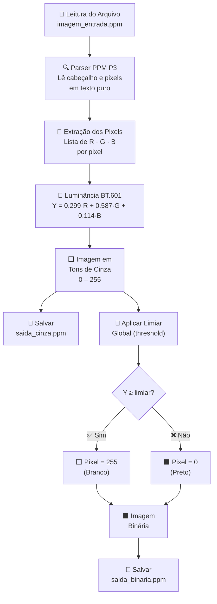

# 🎨 Conversor de Imagem: Colorida → Tons de Cinza → Binária

<div align="center">


-00C853?style=for-the-badge&logo=python&logoColor=white)


**Pipeline completo de conversão de imagem implementado do zero — sem OpenCV, sem Pillow, sem dependências externas**

[🔬 Como Funciona](#-como-funciona) • [🧮 Fórmulas](#-fórmulas-utilizadas) • [💻 Código](#-estrutura-do-código) • [🚀 Como Executar](#-como-executar) • [📸 Resultados](#-resultados)

</div>

---

## 📌 Sobre o Projeto

Este repositório demonstra, de forma **didática e transparente**, o que acontece **por baixo dos panos** quando uma biblioteca como OpenCV ou Pillow converte uma imagem.

> Todo o pipeline é escrito **à mão**, usando apenas recursos **nativos da linguagem Python** — sem bibliotecas externas, sem atalhos. Apenas lógica, matemática e pixels.

A proposta é mostrar o **funcionamento real** dos algoritmos de processamento de imagem:

| 🔢 Etapa | 🎨 Entrada | ➡️ | 🖼️ Saída | 🔬 Técnica |
|---|---|---|---|---|
| **1** | 🎨 Imagem Colorida (RGB) | → | ⬜ Tons de Cinza | Luminância BT.601 |
| **2** | ⬜ Tons de Cinza (0–255) | → | ⬛ Binária | Limiar Global |

---

## 🔬 Como Funciona

### 🗂️ Formato de Entrada — PPM (P3)

O projeto lê imagens no formato **PPM Portable Pixmap (P3)** — um formato de texto puro, sem compressão, ideal para processamento manual:

```
P3                  ← Magic number (RGB texto)
# Comentário
640 480             ← Largura x Altura
255                 ← Valor máximo por canal
255 0 0             ← Pixel (1,1): R=255, G=0,  B=0   → vermelho
0 255 0             ← Pixel (1,2): R=0,   G=255, B=0   → verde
0 0 255             ← Pixel (1,3): R=0,   G=0,   B=255 → azul
...
```

> ✅ Por ser um arquivo de **texto puro**, pode ser lido linha a linha com `open()` nativo — sem nenhuma biblioteca de imagem.

---

## 🧮 Fórmulas Utilizadas

### 1️⃣ Conversão para Tons de Cinza — Luminância BT.601

A fórmula de **luminância BT.601** (padrão ITU-R) pondera os canais RGB de acordo com a **sensibilidade do olho humano** a cada cor:

```
Y = 0.299 × R + 0.587 × G + 0.114 × B
```

| 🎨 Canal | ⚖️ Peso | 👁️ Motivo |
|---|:---:|---|
| 🔴 **R** (Vermelho) | **0.299** | Sensibilidade moderada do olho |
| 🟢 **G** (Verde) | **0.587** | Canal com **maior** peso — olho é mais sensível ao verde |
| 🔵 **B** (Azul) | **0.114** | Canal com **menor** peso — olho é menos sensível ao azul |

> 💡 Essa é exatamente a mesma fórmula usada internamente pelo **OpenCV** e pelo **Pillow** na conversão `RGB → GRAY`.

---

### 2️⃣ Binarização — Limiar Global (Threshold)

Após a conversão para tons de cinza, cada pixel é classificado como **preto ou branco** com base em um limiar:

```
Pixel Binário = 255   se Y ≥ limiar  →  ⬜ Branco
Pixel Binário =   0   se Y <  limiar  →  ⬛ Preto
```

```
  Tons de Cinza             Binária
  ┌─────────────────┐       ┌─────────────────┐
  │  87  200  34    │       │   0  255   0    │
  │ 162   45 210    │  →    │ 255    0  255   │
  │  12  178  99    │  →    │   0  255    0   │
  │ 240   67 155    │       │ 255    0  255   │
  └─────────────────┘       └─────────────────┘
      (0–255)                  limiar = 128
```

---

## 🖼️ Pipeline Visual

```
  ┌────────────────────────────────────────────────────────────────┐
  │                    🎨 PIPELINE DE CONVERSÃO                    │
  ├────────────────┬───────────────────┬───────────────────────────┤
  │  ENTRADA       │    ETAPA 1        │    ETAPA 2                │
  │                │                   │                           │
  │  🎨 RGB        │  ⬜ CINZA        │  ⬛ BINÁRIA               │
  │  R   G   B     │  Y = 0–255        │  P ∈ {0, 255}             │
  │  255  87   0   │  →  101           │  →  0    (< 128)          │
  │   12 200  34   │  →  154           │  →  255  (≥ 128)          │
  │  180  45 210   │  →   84           │  →  0    (< 128)          │
  │                │                   │                           │
  │  PPM P3        │  luminância       │  limiar global            │
  │  (texto puro)  │  BT.601           │  (padrão: 128)            │
  └────────────────┴───────────────────┴───────────────────────────┘
```

---

## 💻 Estrutura do Código

```
📦 conversor-imagem-python/
 ├── 🐍 conversor.py          # Pipeline principal de conversão
 ├── 🖼️  imagem_entrada.ppm   # Imagem de objetos geométricos (PPM P3)
 ├── ⬜ saida_cinza.ppm       # Resultado: tons de cinza
 ├── ⬛ saida_binaria.ppm     # Resultado: imagem binarizada
 └── 📄 README.md
```

### 🐍 Funções Principais

```python
def ler_ppm(caminho: str) -> tuple:
    """
    Lê uma imagem PPM P3 (texto puro) sem bibliotecas externas.
    Retorna: (largura, altura, lista de pixels [R, G, B])
    """

def rgb_para_cinza(pixels: list) -> list:
    """
    Converte pixels RGB para tons de cinza usando luminância BT.601.
    Y = 0.299·R + 0.587·G + 0.114·B
    Retorna: lista de valores inteiros (0–255)
    """

def cinza_para_binario(cinza: list, limiar: int = 128) -> list:
    """
    Binariza os pixels de cinza com base em um limiar global.
    Retorna: lista de valores 0 ou 255
    """

def salvar_ppm(caminho: str, largura: int, altura: int, pixels: list) -> None:
    """
    Salva o resultado como arquivo PPM P3 (texto puro).
    """
```

---

## 🗺️ Pipeline de Processamento



---

## 🚀 Como Executar

### 1️⃣ Clone o Repositório

```bash
git clone https://github.com/seu-usuario/conversor-imagem-python.git
cd conversor-imagem-python
```

### 2️⃣ Execute o Conversor

```bash
python conversor.py
```

> ✅ **Nenhuma instalação adicional necessária.** O projeto usa apenas Python puro.

### 3️⃣ Personalize o Limiar (opcional)

```python
# No arquivo conversor.py, ajuste o limiar de binarização:
binario = cinza_para_binario(pixels_cinza, limiar=128)  # 0–255
```

| 🎚️ Limiar | 🖼️ Efeito |
|---|---|
| **64** | Mais pixels brancos — imagem mais clara |
| **128** | Equilíbrio padrão |
| **192** | Mais pixels pretos — imagem mais escura |

---

## 📸 Resultados

> 📌 Adicione aqui capturas de tela das três etapas do pipeline.

```
  ORIGINAL (RGB)         TONS DE CINZA          BINÁRIA
  ┌─────────────┐        ┌─────────────┐        ┌─────────────┐
  │  🔴 🟢 🔵  │        │  ░ ▒ ▓ █   │        │  ⬜ ⬛ ⬜  │
  │  🟡 🟣 🟤  │  →     │  ▒ █ ░ ▓   │  →     │  ⬛ ⬜ ⬛  │
  │  🔶 🔷 🟩  │        │  ░ ▒ █ ░   │        │  ⬜ ⬛ ⬜  │
  └─────────────┘        └─────────────┘        └─────────────┘
   imagem_entrada.ppm     saida_cinza.ppm        saida_binaria.ppm
```

---

## 🆚 Por que Python Puro?

<div align="center">

| 🔬 Critério | 🐍 Python Puro (este projeto) | 📦 OpenCV / Pillow |
|---|:---:|:---:|
| 📚 **Didático** | ✅ Transparente | ❌ Abstrato |
| 🔍 **Visibilidade do algoritmo** | ✅ Total | ❌ Oculto |
| ⚡ **Performance** | ❌ Mais lento | ✅ Otimizado |
| 📦 **Dependências** | ✅ Zero | ❌ Requer instalação |
| 🎓 **Valor educacional** | ✅ Muito alto | ➖ Médio |
| 🔧 **Uso em produção** | ❌ Não recomendado | ✅ Ideal |

</div>

---

## 🧠 Conceitos Abordados

| 📚 Conceito | 🔬 Descrição |
|---|---|
| 🎨 **Modelo de Cor RGB** | Representação digital de cores como tripla (R, G, B) |
| 👁️ **Luminância BT.601** | Ponderação perceptual baseada na sensibilidade do olho humano |
| 📐 **Espaço de Cor** | Conversão entre espaços cromáticos distintos |
| 📏 **Limiar Global** | Segmentação binária com threshold fixo |
| 🗂️ **Formato PPM** | Formato de imagem baseado em texto, sem compressão |
| 🔢 **Manipulação de Pixels** | Acesso e modificação direta de valores de pixel |

---

## 🛠️ Tecnologias Utilizadas

<div align="center">

| 🛠️ Tecnologia | 📌 Uso |
|---|---|
|  | Linguagem única — sem dependências externas |
|  | Formato de imagem em texto puro |
|  | Padrão ITU-R de conversão RGB→Cinza |
|  | Algoritmo de binarização por threshold |

</div>

---

## 🎓 Competências Desenvolvidas

- 🎨 Compreensão do **modelo de cor RGB** e representação de pixels
- 👁️ Aplicação da **luminância BT.601** para conversão perceptual
- 📏 Implementação de **binarização por limiar global**
- 🗂️ Leitura e escrita de **arquivos de imagem em formato texto (PPM)**
- 🐍 Uso avançado de **Python puro** sem bibliotecas externas
- 🔬 Entendimento do funcionamento **interno das bibliotecas de visão computacional**
- 🧮 Aplicação prática de **álgebra e processamento de sinais** em imagens

---

## 🔗 Referências

- 📄 [ITU-R BT.601 — Luminância](https://www.itu.int/rec/R-REC-BT.601)
- 🖼️ [Formato PPM — Netpbm](https://netpbm.sourceforge.net/doc/ppm.html)
- 🔬 [Image Thresholding — OpenCV Docs](https://docs.opencv.org/4.x/d7/d4d/tutorial_py_thresholding.html)
- 📚 [Digital Image Processing — Gonzalez & Woods](https://www.imageprocessingplace.com)
- 🎓 [DIO — Digital Innovation One](https://www.dio.me)

---

## 👤 Autor

<div align="center">

**Desenvolvido com 🧠 — processamento de imagem do zero, apenas com Python puro.**

[](https://www.dio.me)
[](https://github.com)
[](https://linkedin.com)

</div>

---

<div align="center">

⭐ **Se este projeto foi útil ou interessante, considere deixar uma estrela no repositório!** ⭐

`🎨 Visão Computacional` • `🐍 Python Puro` • `⬜ Tons de Cinza` • `⬛ Binarização` • `🧮 BT.601` • `📐 Processamento de Imagem`

</div>
